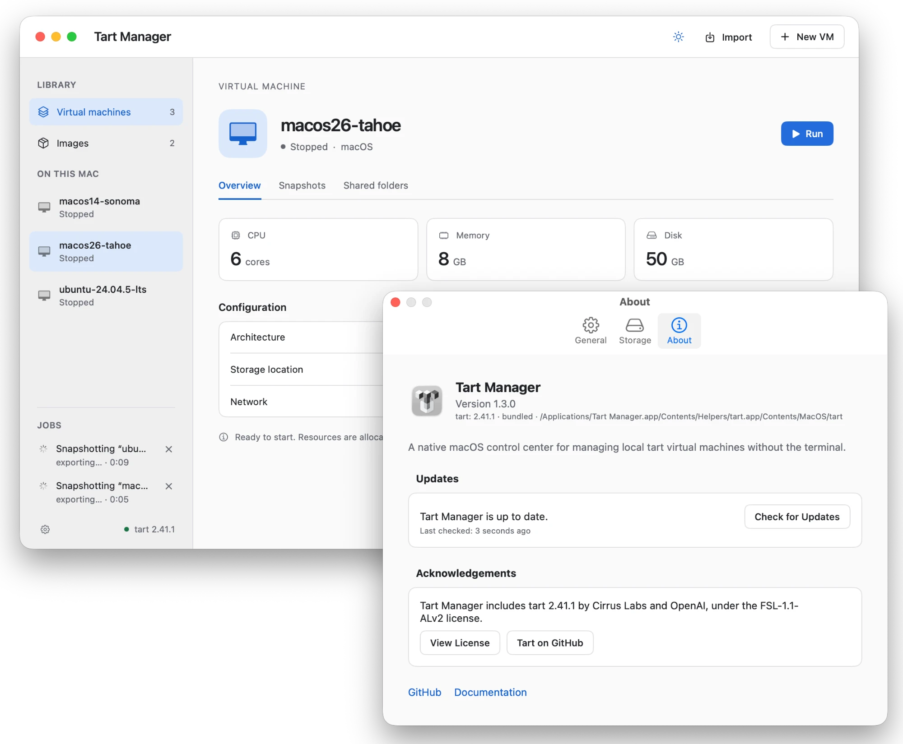

<p align="center">
  <picture>
    <source
      media="(prefers-color-scheme: dark)"
      srcset="Assets/Logo-dark.svg">
    
  </picture>
</p>

Tart Manager is a native macOS control center for people who run
[tart](https://github.com/openai/tart) virtual machines and want to
manage them without the terminal.

Run, stop, suspend, configure, create, and maintain your local tart VMs from
one app. Tart Manager keeps tart as the VM engine; it gives its local
inventory a macOS interface.

<p align="center">
  
</p>

> **Status:** Tart Manager is in early development. Feedback and bug reports
> are welcome.

## What you can do

- See your local VM inventory and run, resume, suspend, gracefully stop, or
  force-stop a VM.
- Create VMs from OCI images or IPSW restore images, import `.tvm` archives,
  and clone existing VMs.
- Configure VM resources, hardware identity, and shared folders; replace a
  stopped VM's disk when needed.
- Create, restore, and remove snapshots before experimenting with a VM.
- Watch clone, import, export, create, and cache-cleanup jobs in the sidebar
  **Jobs** section, and cancel a job that you no longer need.
- Manage registry sign-in, cache cleanup, storage location, and appearance in
  Settings.
- Control common VM actions from the macOS menu bar while retaining the same
  safety checks as the main app.

## Requirements

- macOS 14 (Sonoma) or later on an Apple silicon (ARM64) Mac.
- [tart](https://github.com/openai/tart) 2.0.0 or later. Tart Manager
  does not bundle tart.

Install tart with Homebrew:

```sh
brew install cirruslabs/cli/tart
```

## Install

Download the DMG from the [latest GitHub release](../../releases/latest),
open it, and drag **Tart Manager** to **Applications**. The app is distributed
separately from tart, so install the requirement above first.

> **Unsigned release:** Tart Manager is not signed with an Apple Developer ID
> or notarized. The first time you open it, macOS blocks it because it cannot
> verify the developer. To open it on macOS 15 or later, open
> **System Settings** → **Privacy & Security**, click **Open Anyway** next to
> the Tart Manager message, and confirm. On macOS 14, Control-click the app,
> choose **Open**, then confirm **Open** again.

You do this only once. Later versions install from inside the app (see
[Updates](#updates)) and open with no warning.

If you use Tart Manager 1.0.0 or 1.1.0, install 1.2.0 from the DMG one time.
Those versions do not have the updater.

## Get started

1. Open Tart Manager from Applications.
2. Choose the folder that contains your tart VM storage. The default is
   `~/.tart`.
3. Select a VM in the inventory and choose **Run**, or create one from an OCI
   image or IPSW restore image.

If the storage volume is unavailable, Tart Manager shows the cause and the
affected path, and lets you retry or choose another folder without restarting.
Tart Manager also checks storage again every 30 seconds and when you switch
back to the app, so the VM list comes back after you mount the volume.

## Choosing the tart

**Settings** → **General** → **Tart** selects the tart that Tart Manager
uses:

- **Bundled** uses the tart inside Tart Manager. This choice comes with a
  later release. Until then, it shows "Not available in this build".
- **Path** uses the tart installed on this Mac. Tart Manager finds it in
  the Homebrew folders, then in `PATH`. Click **Choose…** to select another
  tart file, and **Reset** to go back to automatic detection.

**Active tart** shows the version and source in use. Hold the pointer over
it to see the full path. A change applies at once. You cannot change the
tart while a job runs.

If the selected tart is missing, damaged, or too old, a banner in the main
window says what to do. When the other tart works, the banner also offers to
switch to it. Tart Manager never switches by itself.

When both tarts work, Tart Manager asks once which one to use. Until you
answer, it keeps the installed tart. Settings and this question warn you
when the selected tart is older than the other one, because VMs that a
newer tart changed can fail to open with an older tart.

## Using your VMs

- **Running:** macOS VMs that you start from Tart Manager run in tart's
  suspend-capable configuration, so you can suspend them later. This
  configuration disables audio in the macOS guest. Linux guests run normally,
  because tart supports suspend only for macOS.
- **Stopping:** **Stop** asks the guest to shut down. If the guest does not
  shut down in tart's 30-second grace period, tart stops the VM. **Force
  Stop** stops the VM immediately and can lose unsaved guest work, so it
  always asks you to confirm.
- **Suspending:** **Suspend** saves a running macOS VM's session, closes its
  window, and frees its memory. **Resume** continues the session with no cold
  boot. Tart Manager shows **Suspend** only when it can confirm that the VM
  runs with `--suspendable`.
- **Replacing a disk:** **Replace Disk** (in the context menu of a stopped
  VM) copies a raw disk image (`.img`) over the VM's disk and permanently
  deletes the old contents. You must type the VM's name to confirm. Stop a
  running or suspended VM first. You cannot cancel the replacement after it
  starts.
- **Memory warnings:** Before a VM starts, Tart Manager adds its memory to the
  memory of the running VMs. When the total reaches 90% of the Mac's
  physical memory, a warning shows the numbers and lets you continue or
  cancel. The warning is advisory: tart decides whether the VM starts.
- **Pruning caches:** **Settings** → **Storage** → **Maintenance** offers
  **Manual** or 7, 14, or 30 days. A day-based choice removes caches that
  were not used in that many days, at launch and once a day. **Manual**
  turns off automatic cleanup. **Prune Caches** removes all caches after you
  confirm. Cleanup never removes VMs or snapshots.

## Updates

Tart Manager checks for a new version once a day. When one is available,
an **Update Available** button shows next to the title in the main window,
and the menu-bar menu shows **Update available…**. No window opens by
itself.

- Click **Update Available** to read the release notes and choose
  **Install Update**, **Skip This Version**, or **Remind Me Later**.
- To check now, open **Settings** → **About** and click
  **Check for Updates**. **Tart Manager** → **About Tart Manager** also opens
  this tab.
- To turn off the daily check, open **Settings** → **General** and turn off
  **Check for updates automatically**.

Tart Manager verifies the signature of each update before it installs it.
If clone, import, export, create, or other jobs run, the relaunch waits until
they finish, and the button shows how many jobs it waits for. VMs continue to
run during the relaunch.

After an update, macOS can ask again for access to files and folders.

**Privacy:** The update check sends no system profile. GitHub, which hosts
the update feed, receives your IP address and the app's user agent.

## Documentation

- [Development guide](Docs/DEVELOPMENT.md) — build, test, and contribute.
- [Deployment guide](Docs/DEPLOYMENT.md) — package, sign, configure, and
  operate the app.
- [Changelog](CHANGELOG.md) — release history and unreleased changes.
- [License](LICENSE) — MIT License.

## Acknowledgments

Huge thanks to the creators and contributors of
[Tart](https://github.com/openai/tart), the virtualization toolset that makes
Tart Manager possible. Tart builds on Apple's Virtualization.framework to run
macOS and Linux VMs on Apple silicon.
